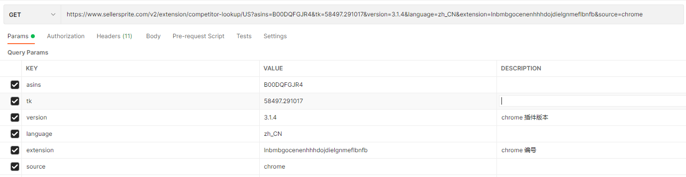
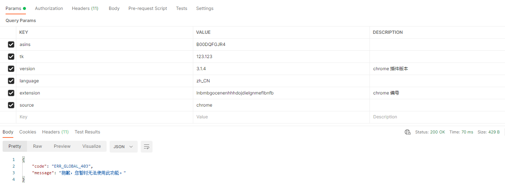
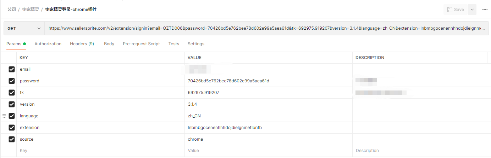

本文保留 2022 年对卖家精灵 Chrome 扩展 3.1.4 的分析过程。扩展 ID、截图、接口字段和版本派生常量均属于当时样本；整理后的代码只用于离线复现参数计算，不表示当前扩展、登录流程或第三方服务仍采用相同实现。文中的 `e`、`t` 是不同函数各自的局部形参，含义需要结合调用位置判断。

以下 `static` 方法和接口调用是从扩展摘录的分析片段，不能单独作为脚本运行；第 6 步的三个普通函数才是可保存执行的 `sellersprite.js`。路径中的“用户名”为占位值，`B00DQFGJR4` 是当时分析用的固定 ASIN 样本，无需请求产品或私有接口即可验证计算结果。

1. chrome://version, 查看 `个人资料路径`

   ```bash
   C:\Users\用户名\AppData\Local\Google\Chrome\User Data\Default
   ```

2. 打开插件所在文件夹: `Extensions`, 目录如下:

   ```bash
   C:\Users\用户名\AppData\Local\Google\Chrome\User Data\Default\Extensions
   ```

3. `chrome://extensions/` 查看卖家精灵插件 ID

   ```bash
   ID：lnbmbgocenenhhhdojdielgnmeflbnfb
   ```

4. 根据插件ID, 寻找对应的文件夹并使用编辑器打开

5. 卖家精灵产品查询分析流程

   1. URL分析

      

   2. `tk` 参数分析

      1. B00DQFGJR4 不变, 更改 tk 的值, 提示无法使用此功能, 因此, tk 参数并不是随机生成的, 而是与 asin 有关

         

      2. 使用编辑器, 全局搜索 `tk` ,  发现 tk 参数, 都是由 `N.a.s2Tkk(t)` 方法生成

         ```js
               static asins(e, t) {
                         return ve(this, void 0, void 0, (function*() {
                       const a =
                                 yield n.a.get(`${this.ASINS_URL}/${e.code}`, {
                                     params: {
                                         asins: t,
                                         tk: N.a.s2Tkk(t)
                                     }
                                 });
                             return new Promise(e => e(this.parseList(a)))
                         }))
                     }
         ```

         调用 s2Tkk(t), 其中 t 参数和 asins: t, 为同一个, 因此得知, t: 为我们需要查询的 asin

      3. 进入 `s2Tkk` 方法

         ```js
                         static s2Tkk(e, t, s, a) {
                             let n = [],
                                 o = [e, t, s, a];
                             for (let e = 0; e < o.length; e++)
                                 if (o[e] && null != o[e] && o[e].toString().length > 0) {
                                     let t = n.length;
                                     for (let t = 0; o[e] instanceof Array && t < o[e].length; t++) n.push(o[e][t]);
                                     t === n.length && n.push(o[e].toString())
                                 }
                             return n.length < 1 ? "" : this._cal(n.join(""), this.EXT_VERSION)
                         }
         ```

         重点在于 `this._cal()` 方法与 `this.EXT_VERSION`参数

      4. Ctrl + F 查找 this._cal() 方法, 得到了参数计算方法（这里不能据此将它视为安全的加密或身份认证）

         ```js
                         static _cal(e, t) {
                             function s(e, t) {
                                 for (var s = 0; s < t.length - 2; s += 3) {
                                     var a = t.charAt(s + 2);
                                     a = "a" <= a ? a.charCodeAt(0) - 87 : Number(a), a = "+" == t.charAt(s + 1) ? e >>> a : e << a, e = "+" == t.charAt(s) ? e + a & 4294967295 : e ^ a
                                 }
                                 return e
                             }
                             return function(e, t) {
                                 var a = t.split(".");
                                 t = Number(a[0]) || 0;
                                 for (var n = [], o = 0, i = 0; i < e.length; i++) {
                                     var r = e.charCodeAt(i);
                                     128 > r ? n[o++] = r : (2048 > r ? n[o++] = r >> 6 | 192 : (55296 == (64512 & r) && i + 1 < e.length && 56320 == (64512 & e.charCodeAt(i + 1)) ? (r = 65536 + ((1023 & r) << 10) + (1023 & e.charCodeAt(++i)), n[o++] = r >> 18 | 240, n[o++] = r >> 12 & 63 | 128) : n[o++] = r >> 12 | 224, n[o++] = r >> 6 & 63 | 128), n[o++] = 63 & r | 128)
                                 }
                                 for (e = t, o = 0; o < n.length; o++) e = s(e += n[o], "+-a^+6");
                                 return e = s(e, "+-3^+b+-f"), 0 > (e ^= Number(a[1]) || 0) && (e = 2147483648 + (2147483647 & e)), (a = e % 1e6).toString() + "." + (a ^ t)
                             }(e, t)
                         }
         ```

         根据 `this._cal(n.join(""), this.EXT_VERSION)` 的调用位置，可以明确 `_cal(e, t)` 的两个参数：

         ```text
         e: "B00DQFGJR4"        # s2Tkk 汇总后的 ASIN 字符串
         t: "300104.1364508470" # 下文 3.1.4 样本派生的 EXT_VERSION
         ```

         原先调用 `s2Tkk('', 'B00DQFGJR4')` 时的空值会被过滤，不能把那里的第一个空参数误认为 `_cal` 的输入。

      5. 同理可查找到, this.EXT_VERSION 参数

         ```js
                         static init() {
                             this.EXT_VERSION = a.a.version().replace(/\./, "00").replace(/\./g, "0") + ".1364508470"
                         }
         ```

         其中 `a.a.version()` 在当时样本中为扩展版本号 `3.1.4`，经这里的替换得到 `300104.1364508470`。这是历史样本常量；新版实现需要重新分析，不能保证只改版本号就能适配。

      6. 将上面的 js 代码整理一下, 如下

         ```js
         function extVersion() {
             // 就是插件的版本, 替换了 . 再拼接了一个字符串而成
             // 固定 2022 年样本，不代表当前扩展实现
             const chrome_ext_version = '3.1.4' //300104.1364508470
             return chrome_ext_version.replace(/\./, "00").replace(/\./g, "0") + ".1364508470"

         }

         function s2Tkk(e, t, s, a) {
             let n = [],
                 o = [e, t, s, a];
             for (let e = 0; e < o.length; e++)
                 if (o[e] && null != o[e] && o[e].toString().length > 0) {
                     let t = n.length;
                     for (let t = 0; o[e] instanceof Array && t < o[e].length; t++) n.push(o[e][t]);
                     t === n.length && n.push(o[e].toString())
                 }
             return n.length < 1 ? "" : _cal(n.join(""), extVersion())
         }

         function _cal(e, t) {

             function s(e, t) {
                 for (var s = 0; s < t.length - 2; s += 3) {
                     var a = t.charAt(s + 2);
                     a = "a" <= a ? a.charCodeAt(0) - 87 : Number(a), a = "+" == t.charAt(s + 1) ? e >>> a : e << a, e = "+" == t.charAt(s) ? e + a & 4294967295 : e ^ a
                 }
                 return e
             }

             return function (e, t) {
                 var a = t.split(".");
                 t = Number(a[0]) || 0;
                 for (var n = [], o = 0, i = 0; i < e.length; i++) {
                     var r = e.charCodeAt(i);
                     128 > r ? n[o++] = r : (2048 > r ? n[o++] = r >> 6 | 192 : (55296 == (64512 & r) && i + 1 < e.length && 56320 == (64512 & e.charCodeAt(i + 1)) ? (r = 65536 + ((1023 & r) << 10) + (1023 & e.charCodeAt(++i)), n[o++] = r >> 18 | 240, n[o++] = r >> 12 & 63 | 128) : n[o++] = r >> 12 | 224, n[o++] = r >> 6 & 63 | 128), n[o++] = 63 & r | 128)
                 }
                 for (e = t, o = 0; o < n.length; o++) e = s(e += n[o], "+-a^+6");
                 return e = s(e, "+-3^+b+-f"), 0 > (e ^= Number(a[1]) || 0) && (e = 2147483648 + (2147483647 & e)), (a = e % 1e6).toString() + "." + (a ^ t)
             }(e, t)
         }
         ```

      7. 使用 Python 进行离线调用

         本次在 Python 3.12.14、Node.js 24.21.0、PyExecJS 1.5.1 下验证。先确保 `node --version` 可运行，再在隔离环境执行 `python -m pip install "PyExecJS==1.5.1"`。这里保留原文的调用方式；[PyExecJS 已停止维护](https://pypi.org/project/PyExecJS/)，不应将其作为持续维护的依赖推荐。

         将第 6 步保存为 `sellersprite.js`，下面保存为同目录下的 `verify_sellersprite.py`，运行 `python verify_sellersprite.py`。它只在本机执行 JavaScript，不联网。

         ```python
         from pathlib import Path

         import execjs

         node = execjs.get('Node')
         file = Path(__file__).with_name('sellersprite.js')
         ctx = node.compile(file.read_text(encoding='utf-8'))

         asin = 'B00DQFGJR4'
         token = ctx.call('s2Tkk', asin)
         assert ctx.call('extVersion') == '300104.1364508470'
         assert ctx.call('s2Tkk', '', asin) == token
         assert ctx.call('s2Tkk') == ''
         assert token == '58497.291017'
         print(token)  # 固定 3.1.4 样本的离线计算值
         ```

         这个结果复现了文中样本的参数计算，没有验证真实服务是否接受该值。扩展权限、登录凭据、网络接口和新版算法均不在本次验证范围。

      8. 当时对插件登录参数也采用了类似的定位方法，下图仅保留为历史分析记录；这里未提供或验证可运行的登录流程。

         如需要帮助, 可以通过 [Github](https://github.com/CLannadZSY) 联系我

         
