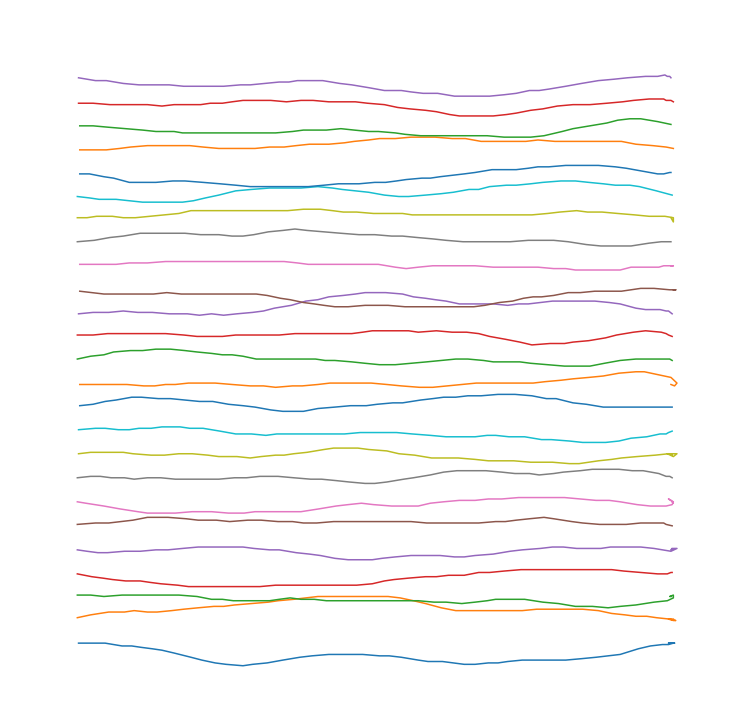
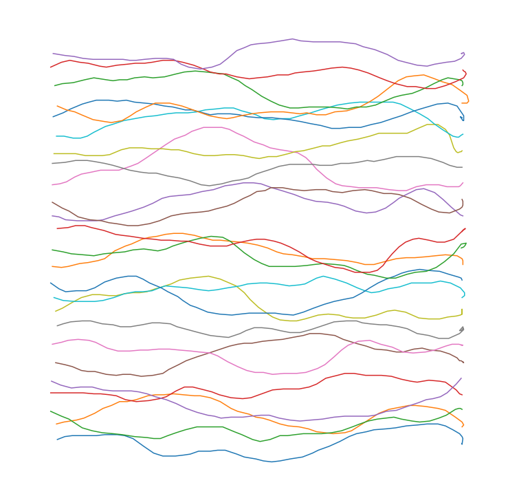

## 运行环境与示例范围

下面保留原作者的 WindMouse 算法和默认参数。函数使用赋值表达式，需要 Python 3.8 或更新版本；本次在 Python 3.12.14、NumPy 2.3.5、Matplotlib 3.10.7 下验证。可在 Python 3.12 的独立环境执行 `python -m pip install "numpy==2.3.5" "matplotlib==3.10.7"`。

示例只记录坐标并绘图，不调用系统鼠标接口，也不模拟真实用户输入。固定随机种子便于复现本次输入；它不能证明任意参数下都会收敛，也不能证明生成轨迹与真实人的行为等价。

## WindMouse

将下面完整函数保存为 `wind_mouse.py`，后面的绘图脚本会从中导入。

```python
import numpy as np
sqrt3 = np.sqrt(3)
sqrt5 = np.sqrt(5)

def wind_mouse(start_x, start_y, dest_x, dest_y, G_0=9, W_0=3, M_0=15, D_0=12, move_mouse=lambda x,y: None):
    '''
    WindMouse algorithm. Calls the move_mouse kwarg with each new step.
    Released under the terms of the GPLv3 license.
    G_0 - magnitude of the gravitational fornce
    W_0 - magnitude of the wind force fluctuations
    M_0 - maximum step size (velocity clip threshold)
    D_0 - distance where wind behavior changes from random to damped
    '''
    current_x,current_y = start_x,start_y
    v_x = v_y = W_x = W_y = 0
    while (dist:=np.hypot(dest_x-start_x,dest_y-start_y)) >= 1:
        W_mag = min(W_0, dist)
        if dist >= D_0:
            W_x = W_x/sqrt3 + (2*np.random.random()-1)*W_mag/sqrt5
            W_y = W_y/sqrt3 + (2*np.random.random()-1)*W_mag/sqrt5
        else:
            W_x /= sqrt3
            W_y /= sqrt3
            if M_0 < 3:
                M_0 = np.random.random()*3 + 3
            else:
                M_0 /= sqrt5
        v_x += W_x + G_0*(dest_x-start_x)/dist
        v_y += W_y + G_0*(dest_y-start_y)/dist
        v_mag = np.hypot(v_x, v_y)
        if v_mag > M_0:
            v_clip = M_0/2 + np.random.random()*M_0/2
            v_x = (v_x/v_mag) * v_clip
            v_y = (v_y/v_mag) * v_clip
        start_x += v_x
        start_y += v_y
        move_x = int(np.round(start_x))
        move_y = int(np.round(start_y))
        if current_x != move_x or current_y != move_y:
            #This should wait for the mouse polling interval
            move_mouse(current_x:=move_x,current_y:=move_y)
    return current_x,current_y
```

## Example

将下面代码保存为同目录下的 `plot_wind_mouse.py`，运行 `python plot_wind_mouse.py`，输出图片 `wind_mouse_examples.png`。[Agg 后端](https://matplotlib.org/stable/users/explain/figure/backends.html)无需图形窗口，适合本地脚本验证；随机种子使用原算法所调用的 [NumPy 全局随机状态](https://numpy.org/doc/2.3/reference/random/generated/numpy.random.seed.html)。

```python
import matplotlib
import numpy as np

matplotlib.use('Agg')  # 必须放在导入 pyplot 之前
import matplotlib.pyplot as plt

from wind_mouse import wind_mouse

np.random.seed(20240317)

fig = plt.figure(figsize=[13,13])
plt.axis('off')
for y in np.linspace(-200,200,25):
    points = []

    def record(x, y):
        if len(points) >= 10000:
            raise RuntimeError('trajectory exceeded the example step limit')
        points.append([x, y])

    end_x, end_y = wind_mouse(0, y, 500, y, move_mouse=record)
    points = np.asarray(points)
    assert points.ndim == 2 and points.shape[1] == 2
    assert np.isfinite(points).all()
    # 算法在连续坐标距离目标小于 1 时停止，回调坐标还经过取整。
    assert np.hypot(end_x - 500, end_y - y) < 2
    plt.plot(*points.T)
plt.xlim(-50,550)
plt.ylim(-250,250)
fig.savefig('wind_mouse_examples.png')
plt.close(fig)
print('25 finite trajectories saved')
```

固定种子的 25 条轨迹均通过有限步数、坐标有限性与终点距离检查。上面的回调步数上限仅用于中断异常示例；原函数本身没有迭代上限。不合理的输入、非正的引力或其他参数组合不在此验证范围，不能直接当作生产环境的安全保证。



这些轨迹可与原作者文章中的人类移动示例进行视觉比较。这里使用 WindMouse 的默认参数，这些参数不一定适合每个用例，可以根据需要调整并观察不同的结果。例如，将风参数设置为等于重力参数，通常会生成更曲折的路径。下图保留原文的高风力示例，并非本次固定种子验证重新生成的结果。



## 转载: [WindMouse](https://ben.land/post/2021/04/25/windmouse-human-mouse-movement/)
